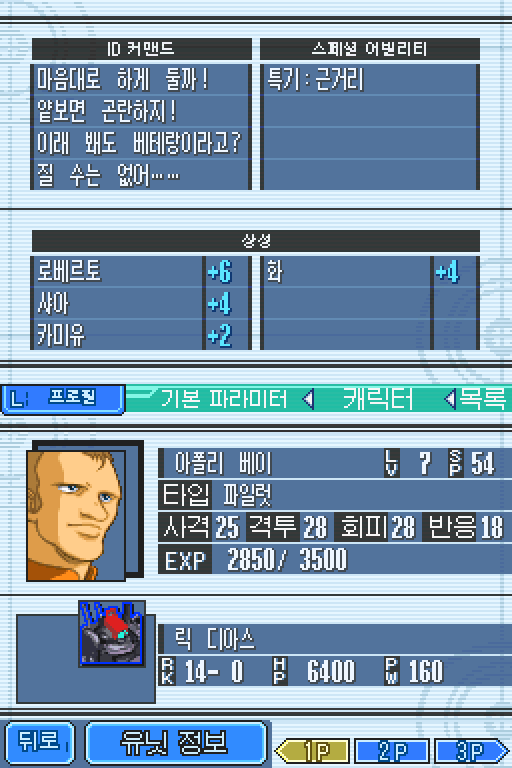
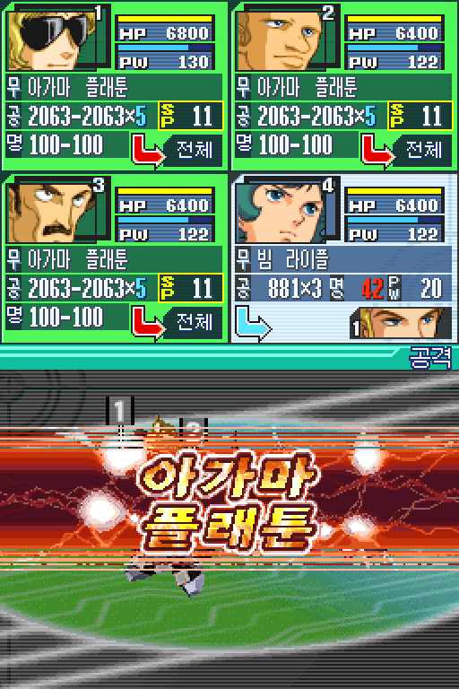
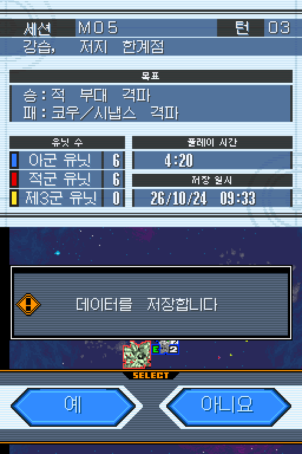
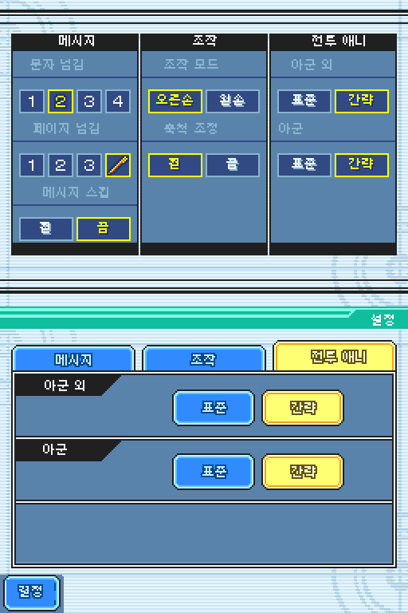

# SD 건담 G 제너레이션 크로스 드라이브 한글화 프로젝트

**닌텐도 DS 게임 『SD 건담 G 제너레이션 크로스 드라이브』 일본판을 한국어로 즐길 수 있도록 만든 비공식 팬 번역 프로젝트입니다.** 시나리오와 전투 대사, 도감, 메뉴, 게임 안 이미지의 문구를 옮기고, 원작의 화면 분위기와 읽기 쉬운 한글 표시를 살리는 데 중점을 둡니다.

[GitHub 저장소](https://github.com/snm01234/NDS-GGNCD-KOR) · [패치 다운로드](https://github.com/snm01234/NDS-GGNCD-KOR/releases) · [오류 제보와 문의](https://github.com/snm01234/NDS-GGNCD-KOR/issues)

| 항목 | 안내 |
|---|---|
| 대상 | Nintendo DS 일본판 『SD Gundam G Generation: Cross Drive』 |
| 배포 버전 | 1.0.0 |
| 패치 방식 | xdelta3 (VCDIFF) |
| 필요한 원본 | 수정하지 않은 일본판 ROM, 128 MiB |

## 프로젝트 소개

이 프로젝트는 게임의 대사와 메뉴를 한국어로 번역하고, 이름·용어·호칭을 원문과 대조해 다듬습니다. 작은 DS 화면에 맞춰 글자 크기와 줄바꿈을 조정하고, 로고·배너·메뉴 이미지 안의 문구도 한국어로 정리합니다. 플레이 중 발견한 미번역, 오역, 글자 잘림과 화면 표시 문제를 계속 확인하고 있습니다.

대표 화면은 저장된 게임 상태와 패치 데이터를 이용해 만든 정적 재구성입니다. 실제 게임을 새로 실행해 촬영한 화면은 아닙니다.

| 캐릭터·능력 정보 | 합동공격 배너 |
|:---:|:---:|
|  |  |

| 저장 확인 화면 | 전투 애니메이션 설정 화면 |
|:---:|:---:|
|  |  |

## 원본 ROM 보유자 전용: 패치 적용

> **패치는 본인이 적법하게 취득해 보유한 일본판 원본에만 적용하세요.** 이 프로젝트는 원본 게임 ROM이나 저장 파일을 제공하지 않습니다. 패치 파일은 ROM을 대신하지 않으며, 지정된 수정 전 일본판 원본에 적용해야 합니다. 본인이 보유하지 않은 ROM을 내려받거나 공유하는 용도로 사용하지 마세요.

배포 패치는 수정하지 않은 일본판 원본에 적용하는 파일입니다. 다른 지역판, 수정된 ROM 또는 다른 한글 패치 결과에 덧붙이면 정상적으로 적용되지 않을 수 있습니다. 파일 이름만으로 원본을 판단하지 말고 [적용 안내](docs/INSTALL.md)의 크기와 체크섬을 확인하세요.

배포 자료에는 xdelta 패치, 설명서, 검증용 해시와 글꼴 라이선스가 들어 있습니다. 원본 ROM은 포함하지 않습니다. 적용 결과는 128 MiB ROM이며, 새 패치를 확인할 때는 게임을 다시 시작하고 기존 savestate 대신 일반 게임 저장을 불러와 주세요.

## 면책·저작권·라이선스

이 프로젝트는 비공식 팬 번역이며 Bandai Namco, Nintendo 또는 게임의 권리자와 제휴·승인 관계가 없습니다. 게임명과 게임 원본의 그래픽·음악·문자열·기타 저작물은 각 권리자에게 권리가 있습니다. 이 README와 패치 배포는 해당 게임 저작물에 대한 권리를 넘기거나 사용 허가를 주지 않습니다.

한글 표시의 바탕이 된 갈무리(Galmuri) 글꼴은 제작자가 정한 **SIL Open Font License 1.1**을 따릅니다. 전체 라이선스는 [FONT_LICENSE_OFL.md](FONT_LICENSE_OFL.md)에서 확인할 수 있습니다. 이 글꼴 라이선스는 게임 ROM이나 게임 저작물, 프로젝트의 번역문과 패치 자료에 적용되지 않습니다. 별도로 명시된 허가가 없는 자료는 권리자의 허락 없이 재배포하거나 상업적으로 이용하지 마세요.

패치와 문서는 있는 그대로 제공하며, 정상 동작이나 특정 목적에 대한 적합성을 보증하지 않습니다. 적용 전 저장 파일을 백업하고, 거주 지역의 법과 이용 조건을 확인하세요. 패치 사용과 결과물 관리는 이용자 책임입니다.

## 문서와 제보

- [적용 안내](docs/INSTALL.md): 원본 확인, 패치 방법, 저장 파일 안내
- [릴리스 노트](docs/RELEASE_NOTES_1.0.0.md): 이번 배포에 대한 변경 요약
- [검증 범위](docs/VERIFICATION.md): 확인한 항목과 정적 재구성의 한계
- [대표 이미지 출처](docs/IMAGE_SOURCES.md): README 화면의 제작 근거
- [GitHub Issues](https://github.com/snm01234/NDS-GGNCD-KOR/issues): 오역·미번역·화면 문제 제보

문제를 제보할 때는 패치 버전, 게임 내 위치, 현재 문구나 화면, 재현 순서를 함께 적어 주세요. 미번역과 표시 오류가 더 발견될 수 있으며, 모든 분기와 실제 기기·에뮬레이터에서의 동작을 완전히 검증한 것은 아닙니다.
